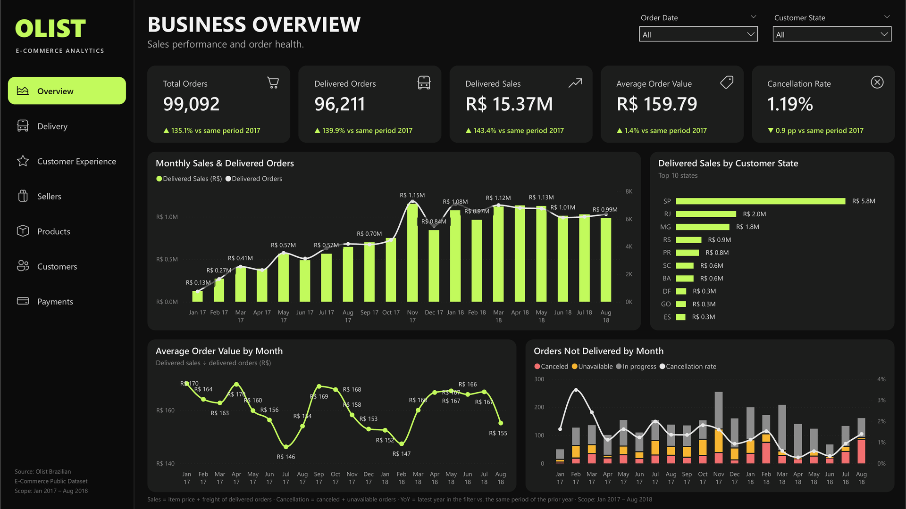
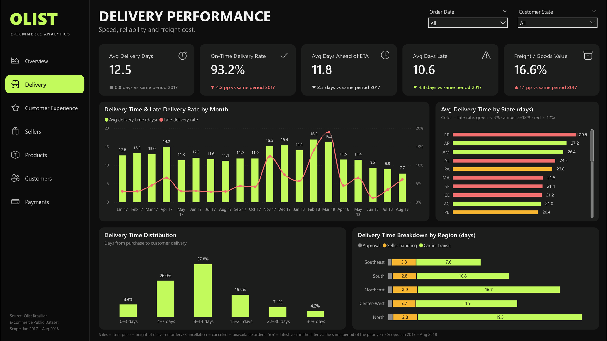
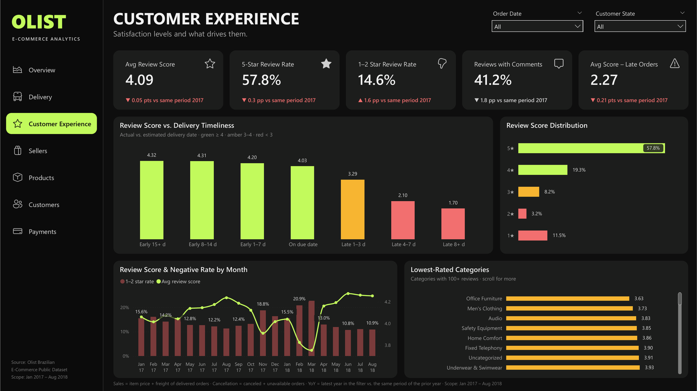
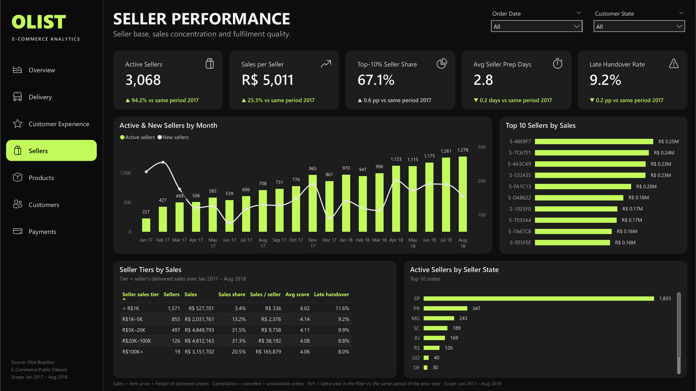
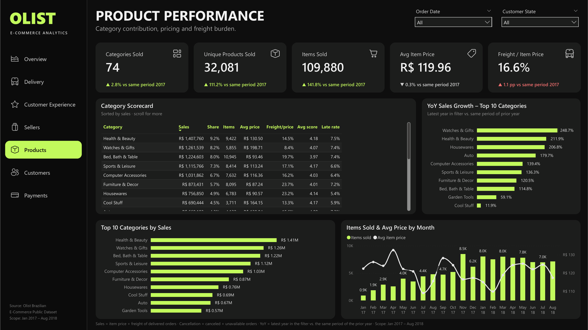
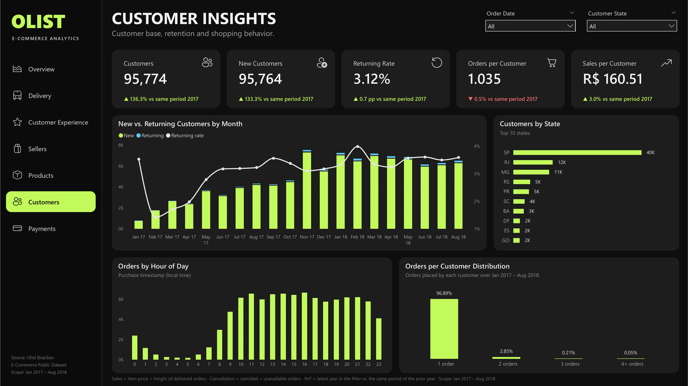
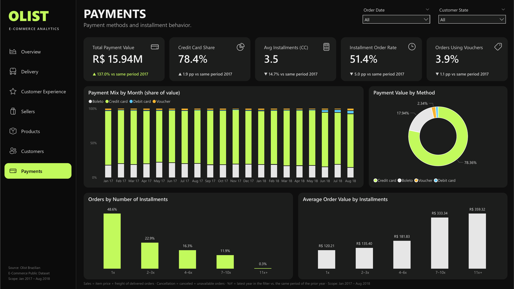

# Olist E-Commerce Analytics – Power BI Dashboard

Seven-page Power BI report on the [Olist Brazilian E-Commerce Public Dataset](https://www.kaggle.com/datasets/olistbr/brazilian-ecommerce), built as a Power BI Project (`Olist.pbip`: TMDL semantic model + PBIR report) in a dark / lime design.

**Scope:** orders placed **Jan 2017 – Aug 2018** (20 complete months, 99,092 orders). Sep–Dec 2016 and Sep–Oct 2018 are excluded because they are sparse (353 orders, 0.35%).



**Quick look:** open `Olist_report.pbix` in Power BI Desktop. It contains the loaded data, so no setup is needed. `Olist.pbip` is the same report as a Power BI Project in plain text (TMDL + PBIR), which needs the data files described under *Rebuilding*.

## Pages

| Page | Question it answers | Main visuals |
|---|---|---|
| **Overview** | How are sales and order volume trending, and how healthy is fulfilment? | Monthly sales & delivered orders, sales by state, AOV trend, orders not delivered by month |
| **Delivery** | How fast and reliable is delivery, and where is it slow? | Delivery time & late rate by month, delivery time by state, delivery-time distribution, approval → seller → carrier breakdown by region |
| **Customer Experience** | How satisfied are customers and what drives low scores? | Review score vs. delivery timeliness, score distribution, score & negative rate by month, lowest-rated categories |
| **Sellers** | How large and concentrated is the seller base, and how well do sellers fulfil? | Active & new sellers by month, top 10 sellers, seller sales tiers, sellers by state |
| **Products** | Which categories drive sales and growth, and what is the freight burden? | Category scorecard, YoY growth of top categories, top 10 categories, items sold & average price |
| **Customers** | Who buys, do they come back, and when do they shop? | New vs. returning customers, customers by state, orders by hour, orders-per-customer distribution |
| **Payments** | How do customers pay and how do installments relate to basket size? | Payment mix by month, value by method, installment distribution, AOV by installments |

Every page has five KPI cards with a **YoY line**: the latest year in the current filter vs. the same date range one year earlier (e.g. Jan–Aug 2018 vs. Jan–Aug 2017). Green/red marks a favourable/unfavourable change; grey marks metrics without a clear good direction. The **Order Date** (year › month) and **Customer State** slicers are synced across pages, and the sidebar buttons navigate between pages (Ctrl+click in Power BI Desktop).

### Screenshots

| | |
|---|---|
|  |  |
| **Delivery** | **Customer Experience** |
|  |  |
| **Sellers** | **Products** |
|  |  |
| **Customers** | **Payments** |

## Key findings (Jan 2017 – Aug 2018)

- **Growth:** Jan–Aug 2018 orders are +135% vs. Jan–Aug 2017; Black Friday lifted Nov 2017 to 7,544 orders (vs. 4,631 in Oct).
- **Geography:** São Paulo alone generates 37% of delivered sales; North and Northeast customers wait 20–23 days on average vs. 11 days in the Southeast.
- **Delivery drives satisfaction:** 6.8% of deliveries are late. Late orders score 2.27★ vs. 4.29★ for on-time orders, and orders more than a week late score 1.7★. Late rate peaked at 19% in Mar 2018.
- **Conservative ETAs:** orders arrive 11.8 days ahead of the estimate on average (estimate ≈ 24 days vs. actual ≈ 12.5 days).
- **Seller concentration:** the top 10% of sellers generate 67% of sales; 19 sellers above R$100K account for 20%.
- **Retention:** 96.9% of customers ordered only once; only 3.1% are returning customers.
- **Payments:** credit cards carry 78% of payment value; average order value rises from R$120 (1 installment) to R$359 (11+ installments).

## Project structure

```
Olist_analyst/
├── olist_*.csv, product_category_name_translation.csv   raw Kaggle files
├── etl/build_model_data.py      clean data → star schema CSVs
├── data_model/*.csv             model tables loaded by Power BI
├── tools/
│   ├── model_tmdl.py            semantic model: tables, relationships, ~170 DAX measures
│   ├── build_pbip.py            report pages, visuals, theme; writes Olist.pbip
│   ├── backgrounds.py, layout.py  page backgrounds (sidebar, KPI panels, icons) and layout grid
│   └── vm/                      PowerShell helpers to refresh/query Power BI Desktop in the VM
├── Olist_report.pbix            the report with data loaded (open directly)
├── Olist.pbip                   the same report as a Power BI Project
├── Olist.SemanticModel/         TMDL model
├── Olist.Report/                PBIR report, theme OlistDark.json, background images
└── docs/img/                    page screenshots
```

### Data model

Star schema with `Orders` as the order-level fact (status, values, delivery times, latest review, payment summary) and `OrderItems` / `Payments` as detail facts:

- `Date` → `Orders[purchase_date]`, `States` → `Orders[customer_state]`, `Customers` → `Orders[customer_unique_id]`
- `OrderItems[order_id]` ↔ `Orders` (both directions, so product/seller filters reach order-level metrics)
- `Products` → `OrderItems`, `Sellers` → `OrderItems`, `Payments[order_id]` → `Orders`

Definitions used throughout: **Sales** = item price + freight of delivered orders; **Cancellation** = `canceled` + `unavailable` orders; **Late** = delivered after the estimated delivery date; **Returning customer** = a customer whose order in the period is not their first.

## Rebuilding

The CSV files are not in the repository. Download the [Kaggle dataset](https://www.kaggle.com/datasets/olistbr/brazilian-ecommerce) and place its nine `olist_*.csv` / `product_category_name_translation.csv` files in the project root, then:

1. `python3 etl/build_model_data.py` – regenerates `data_model/*.csv`.
2. `python3 tools/build_pbip.py --fonts <folder with Segoe UI + SegoeIcons.ttf>` – regenerates the model, report and backgrounds (omit `--fonts` to keep the existing background images; the fonts come from `C:\Windows\Fonts`).
3. Open `Olist.pbip` in Power BI Desktop and **Refresh** (or run `tools/vm/pbi_local.ps1 -Refresh` inside the VM), then save.

The CSV location is the Power Query parameter **DataFolder** (`Y:\Desktop\Olist_analyst\data_model\`, the Mac home folder as mapped by Parallels). Change it under *Transform data → Edit parameters* if the files move.

> Parallels shows files created on the Mac with mode 644 as read-only in Windows, which makes Power BI open the project as **[Read-Only]**. `build_pbip.py` therefore makes the generated files writable.
